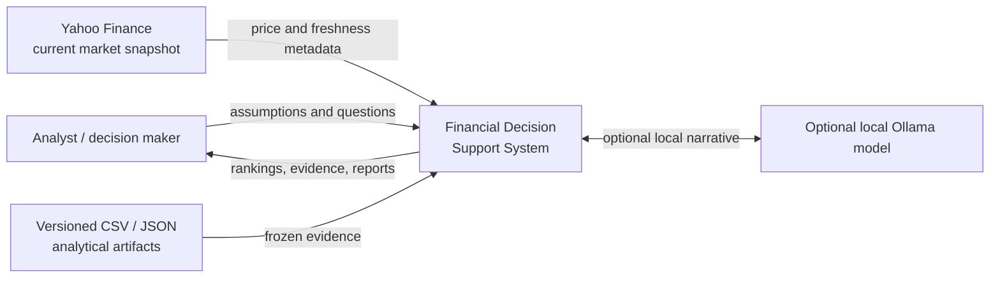
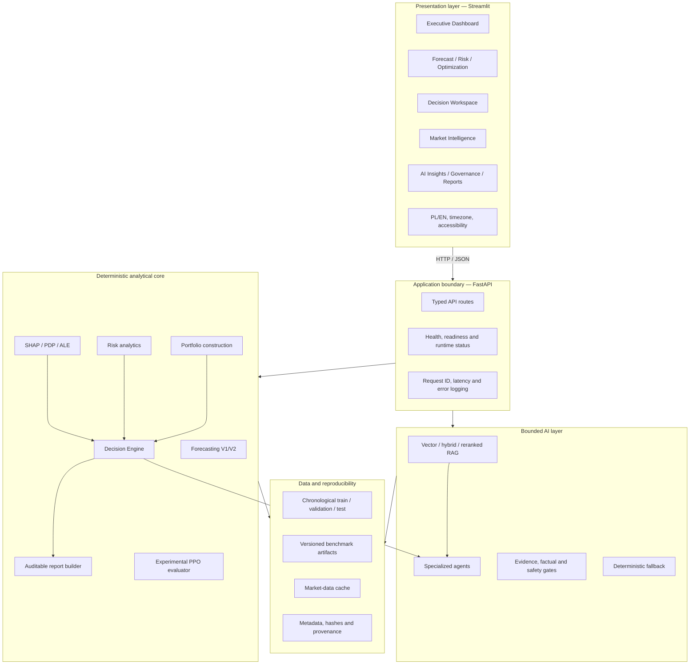
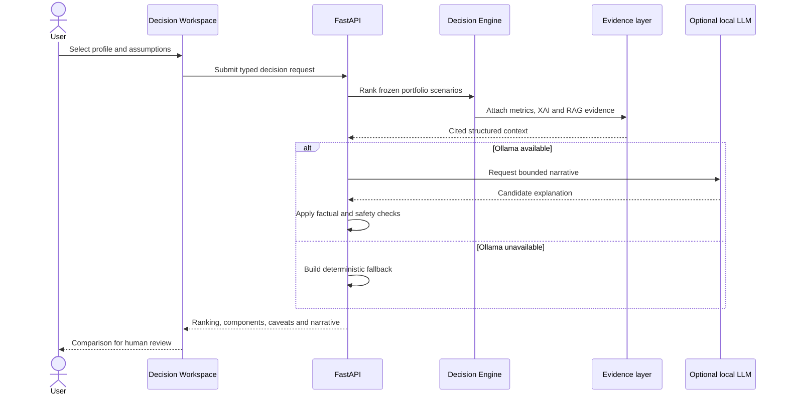

# System architecture

## Purpose

The Financial Decision Support System is a local-first analytical application
that combines quantitative evidence with explainable, human-controlled decision
support. It is deliberately not an automated trading system. Portfolio weights,
model outputs and generated narratives remain inspectable, and the user makes
the final decision.

## Context diagram



Yahoo Finance and Ollama are optional at runtime. Cached market information and
a deterministic narrative fallback keep the core application usable when the
network or local language model is unavailable.

## Container and component view



## Responsibility boundaries

| Component | Owns | Must not do |
|---|---|---|
| Streamlit frontend | interaction, localization, formatting, accessible presentation | retrain models or duplicate financial calculations |
| FastAPI | typed contracts, orchestration, dependency status | silently change analytical assumptions |
| Forecasting | leakage-safe features, targets, validation and benchmarks | tune on the consumed final test split |
| Risk and portfolio | metrics, frozen strategies, contributions and scenarios | present historical optimization as guaranteed performance |
| Decision Engine | deterministic constraints, normalization, scoring and ranking | delegate allocation authority to an LLM |
| RAG and agents | retrieve evidence and explain structured results | invent facts, expose hidden reasoning or override rankings |
| Reporting | preserve assumptions, evidence, provenance and caveats | recalculate or mutate source results |
| Market Intelligence | current snapshot, cache and freshness state | imply real-time streaming or execute trades |
| PPO module | controlled experimental comparison | claim universal superiority from one terminal period |

## Decision flow



The language model explains an already computed decision. It does not choose
weights, alter validation metrics or become a source of financial truth.

## Evaluation and leakage controls

The main evaluation path is chronological:

```text
training -> fitting and portfolio construction
validation -> development decisions and comparisons
final test -> one terminal evaluation after choices were frozen
```

Forecasting V2 does not reopen the consumed V1 test split. It uses development
data, rolling-origin folds, nested selection and bootstrap comparisons. A model
may pass a predictive gate and still fail the economic gate; that happened to
the gradient-boosting challenger and is recorded as a valid negative result.

## Runtime modes

| Mode | Backend | Frontend | Local LLM | Intended use |
|---|---|---|---|---|
| Python development | local process | local process | optional | development and notebook work |
| Docker Compose | isolated container | isolated container | optional host dependency | reproducible demo and smoke test |
| Offline/degraded | available artifacts | available | unavailable | deterministic analytics and fallback narratives |

Both containers run as a non-root application user and expose health checks.
Readiness distinguishes a live process from a system whose required artifacts
are actually available.

## Observability and resilience

- request identifiers connect client-visible errors with structured logs;
- latency and error counters are available through runtime status endpoints;
- health and readiness are separate;
- artifact and Ollama status are explicit;
- market data exposes source, timestamp, freshness and cache state;
- corrupted data, non-finite values, extreme inputs, prompt injection and
  operation without an LLM have dedicated tests;
- CI executes lint, format, split regression and container smoke gates.

## Security, privacy and cost boundary

The implemented default path does not require a paid model API or secret API
key. Generative inference uses an optional local Ollama model. External market
and model-download services may require network access and remain subject to
their own availability and usage terms. Public hosting is intentionally outside
the mandatory local-first architecture.

The repository must not contain credentials, private environment files, local
absolute paths or saved chain-of-thought. Generated reports contain structured
evidence and concise justifications rather than hidden model reasoning.

## Primary implementation locations

- `backend/src/decision/` — deterministic Decision Engine;
- `backend/src/forecast/` — V1 and V2 forecasting experiments;
- `backend/src/portfolio/` and `backend/src/risk/` — portfolio evidence;
- `backend/src/rag/` and `backend/src/agents/` — grounded AI layer;
- `backend/src/reporting/` — auditable decision reports;
- `backend/src/market_intelligence/` — current snapshot and cache;
- `backend/src/observability/` — runtime metrics and request logging;
- `backend/src/api/` — typed application boundary;
- `frontend/` — bilingual, accessible Streamlit application;
- `benchmark_results/` — reproducible analytical evidence;
- `tests/` — unit, integration, API, frontend, resilience and engineering gates.
